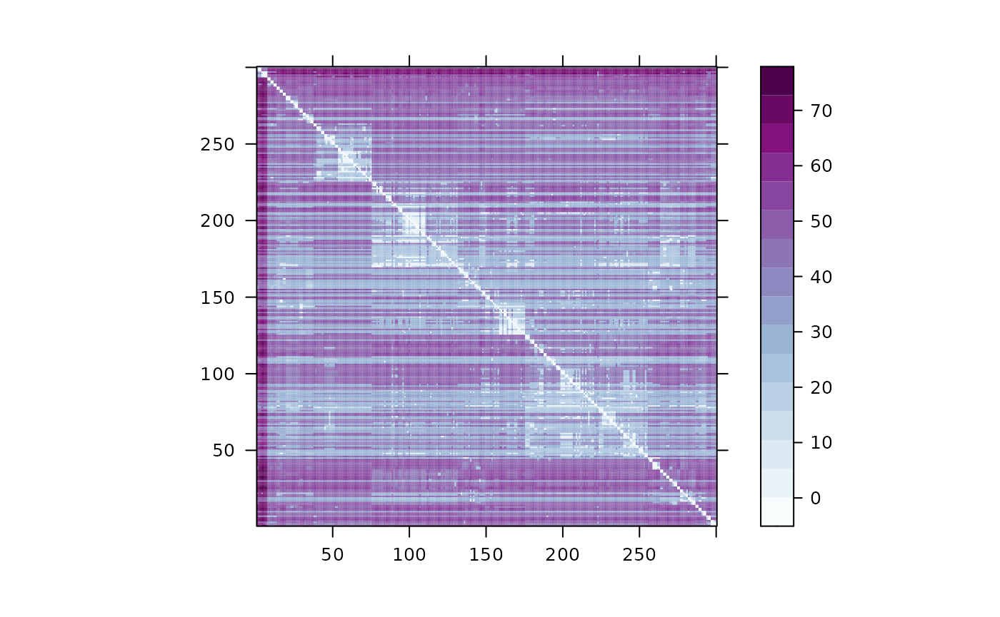
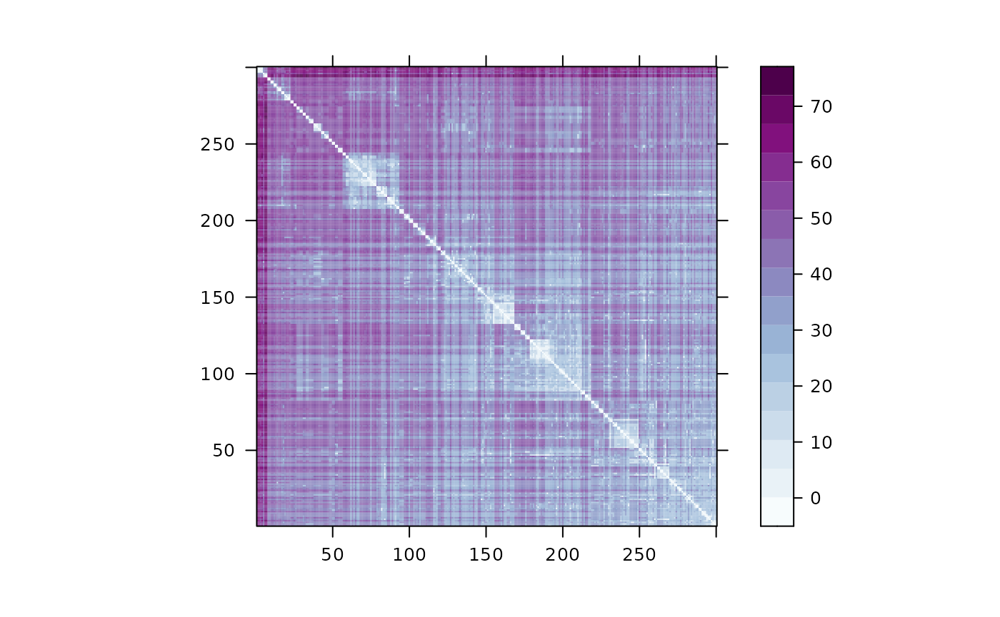

# Decoding a Single Variant

In order to demonstrate how to use to calculate and plot a local
distance matrix $d^{\ell}$, the package comes with an toy dataset of 300
simulated haplotypes, , stored as a $L = 400$ by $N = 300$ .

``` r
require(kalis)
#> Loading required package: kalis
#> 
#> Running in 64-bit mode using x86-64 architecture.
#> Loops unrolled to depth 4.
#> 
#> Currently not using any special instruction sets (WARNING: poor performance likely).
#> If this is unexpected (e.g. your CPU is Intel Haswell or newer architecture, or ARMv7+ with NEON support), then ensure that you are targeting the native architecture in compilation.  The easiest method is to add/change the following line in ~/.R/Makevars
#> CFLAGS=-march=native -mtune=native -O3
data("SmallHaps")
```

maintains a special cache for loading a haplotype dataset (see next
section for details). Since is designed for much larger datasets than
this toy example that we would often never want load into , haplotypes
can be imported directly into the cache using . can only cache and
operate on one haplotype dataset at a time. Currently, requires that the
haplotypes be stored in our custom HDF5 format but support for other
common formats will be added shortly. In the following section we
provide simple instructions for converting common file formats like VCFs
and HAP/SAMPLE/LEGEND generated by SHAPEIT2 to our HDF5 format. However,
if the haplotypes are loaded into a , we can easily import them straight
into the cache using .

``` r
CacheHaplotypes(SmallHaps)
```

From we can inspect the haplotype cache to ensure that the data has
loaded correctly using . With the haplotypes loaded, next we must
specify our model parameters. First we supply a recombination map, $m$,
where $m^{\ell}$ is the distance between variant $\ell$ and $\ell + 1$
in Morgans. Here we randomly generate a recombination map and set the
remaining parameters to their default values.

``` r
m <- rbeta(400-1,1,10)*1e-6
pars <- Parameters(CalcRho(cM = m, s = 1, gamma = 1), mu = 1e-8)
```

Next we must initialize a forward table object with our parameters that
will start at variant $0$ and a backward table object that will start at
the variant $L + 1$. We then use the function to propagate the forward
table using parameters to target variant $250$. We do the same with the
backward table using the function. Note that and do not return anything,
the tables and are updated in place.

``` r
fwd <- MakeForwardTable(pars)
bck <- MakeBackwardTable(pars)

Forward(fwd, pars, 250)
Backward(bck, pars, 250)
```

Now that and are at the same variant, they can be combined to obtain the
posterior marginal copying probabilities, $p^{\ell}$, or a matrix of
distances based on the negative log of those copying probabilities,
$d^{\ell}$, as follows.

``` r

p <- PostProbs(fwd,bck)
d <- DistMat(fwd,bck)
```

The distance matrix can be easily clustered and visualized just by
calling

``` r
plot(d)
```



In some applications, one might want to symmetrize the matrix before
plotting as follows.

``` r
d <- 0.5*(d + t(d))
plot(d)
```


