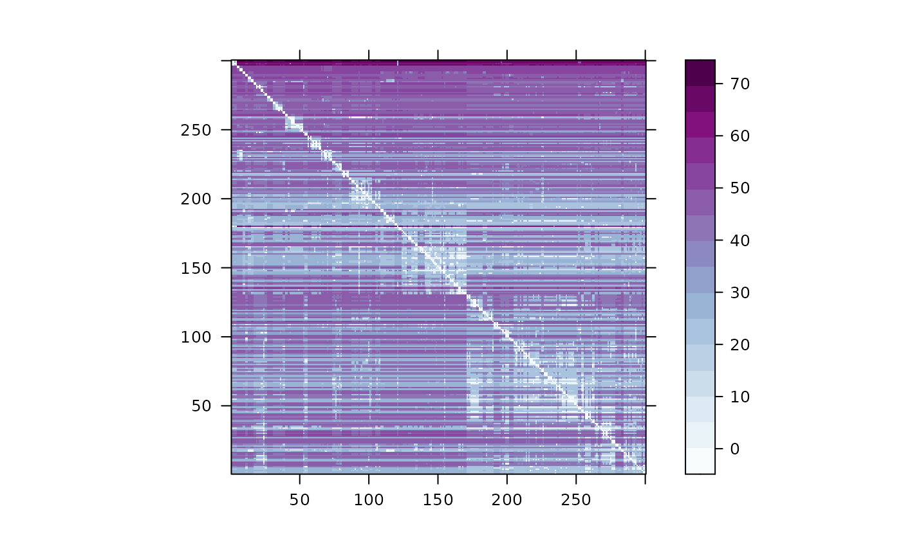

# Iterating Over Loci

Here show how to use to efficiently iterate over loci sequentially.

``` r
require(kalis)
## Loading required package: kalis
## 
## Running in 64-bit mode using x86-64 architecture.
## Loops unrolled to depth 4.
## 
## Currently not using any special instruction sets (WARNING: poor performance likely).
## If this is unexpected (e.g. your CPU is Intel Haswell or newer architecture, or ARMv7+ with NEON support), then ensure that you are targeting the native architecture in compilation.  The easiest method is to add/change the following line in ~/.R/Makevars
## CFLAGS=-march=native -mtune=native -O3

n.checkpoints <- 7

nthreads <- 4
CacheHaplotypes(SmallHaps)

m <- rbeta(L()-1,1,10)*1e-6
pars <- Parameters(CalcRho(cM = m, s = 1, gamma = 1), mu = 1e-8, use.speidel = TRUE)

fwd <- MakeForwardTable(pars)
bck <- MakeBackwardTable(pars)
M <- matrix(0,N(),N())

Iter <- ForwardIterator(pars,n.checkpoints)
## Calculating Optimal Checkpoint Schedule

start.time <- proc.time()

for(t in L():1){
  Iter(fwd,pars,t,nthreads = nthreads)
  Backward(bck,pars,t, nthreads = nthreads)
  if(t==200){plot(DistMat(fwd,bck,M,type="minus.min", nthreads = nthreads))}
  print(paste("At locus",t))
}
```



``` r

print(proc.time() - start.time)
```
